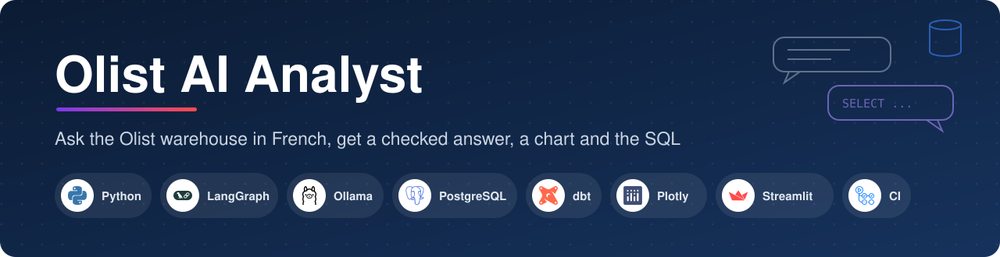
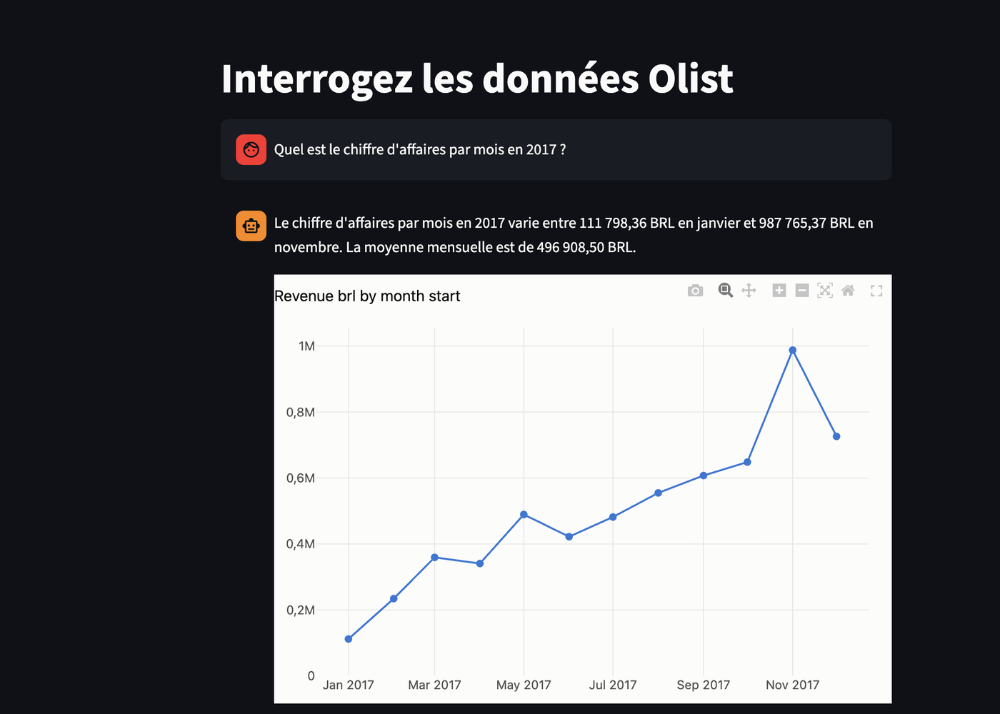
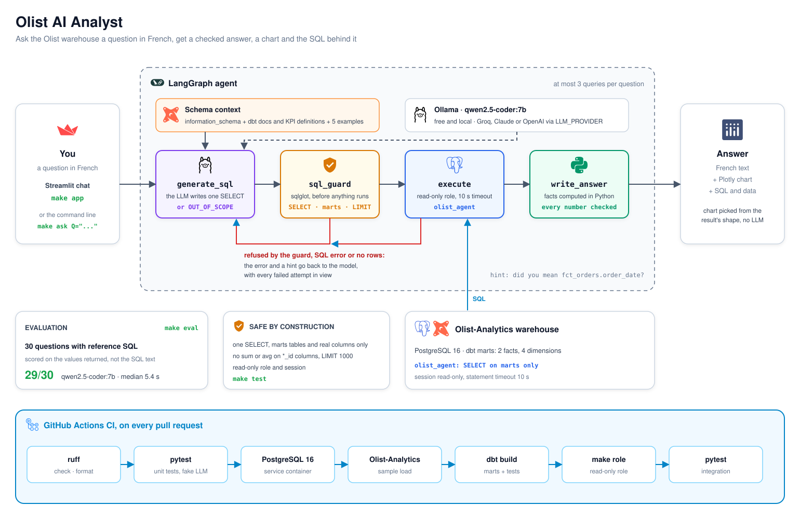
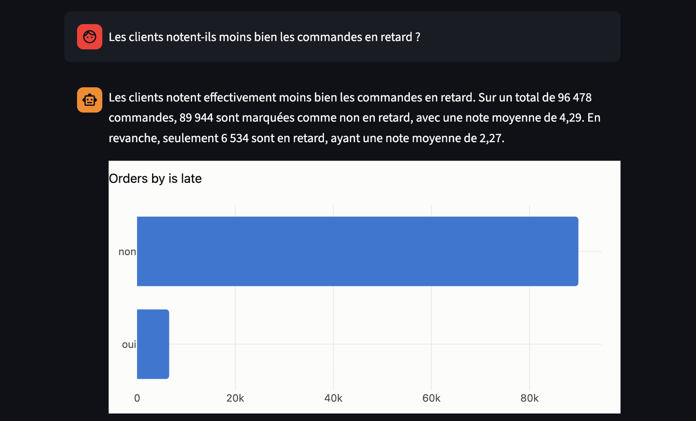
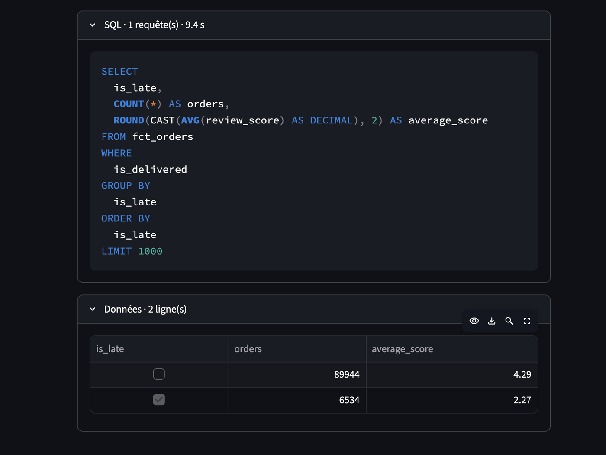

<p align="center">
  
</p>

<p align="center">
  <em>Ask the Olist warehouse a question in French: a local LLM writes the SQL, a guard checks it,
  a read-only role runs it, and Python checks every number of the answer.</em>
</p>

<p align="center">
  <a href="https://github.com/CyrilleAdrien/olist-ai-analyst/actions/workflows/ci.yml"></a>
  
  
  
  
  
  
  <a href="https://creativecommons.org/licenses/by-nc-sa/4.0/"></a>
</p>

<p align="center">
  <a href="#architecture"></a>
  <a href="#tech-stack"></a>
  <a href="#getting-started"></a>
  <a href="#evaluation"></a>
</p>

## What is Olist AI Analyst?

An AI agent that answers business questions in French on the Olist data warehouse: it writes
the SQL, runs it read-only, checks the result and replies with a chart.

It builds on [Olist-Analytics](https://github.com/CyrilleAdrien/Olist-Analytics), which loads
the Olist dataset into PostgreSQL and models it with dbt. The agent only reads the `marts`
schema, through a dedicated read-only role.

Everything runs for free on a laptop: the default model is `qwen2.5-coder:7b` through Ollama,
and it answers **29 of the 30 evaluation questions** correctly (median 5.4 s per question on a
MacBook Pro M3 Pro).

<p align="center">
  
</p>

## Key features

- 🧮 **Grounded answers.** The model writes the SQL and the sentence, Python does the maths:
  totals, averages and extremes are computed from the result, and every number in the answer is
  checked against them before it is shown.
- 🔁 **Self-correcting.** A query refused by the guard, rejected by PostgreSQL or returning no
  rows goes back to the model with the error and a hint (for example where an unknown column
  really lives). At most 3 queries per question.
- 🛡️ **Safe by construction.** sqlglot lets through one `SELECT` on the `marts` schema only, and
  the agent connects with a role that can do nothing else, in a read-only session with a timeout.
- 📏 **Measured.** 30 questions with reference SQL, scored on the values returned, not on how the
  SQL is written. The report is committed for each model.
- ✅ **Tested in CI.** Unit tests with fake models, plus integration tests on a warehouse built
  from Olist-Analytics on every pull request.
- 💸 **Free.** A 7B model on Ollama runs on a laptop; Groq, Claude or OpenAI are one setting away.

## Architecture



The editable source is [docs/olist-ai-analyst-architecture.drawio](docs/olist-ai-analyst-architecture.drawio) (open it on [draw.io](https://app.diagrams.net)).

| Step | Module | What it does |
| --- | --- | --- |
| Schema context | `schema_context.py`, `examples.py` | Tables and columns from `information_schema`, descriptions and KPI definitions from the dbt `manifest.json`, 5 question/SQL examples |
| `generate_sql` | `agent.py`, `llm.py` | The LLM writes one `SELECT`, or `OUT_OF_SCOPE` when the data cannot answer |
| `sql_guard` | `sql_guard.py` | sqlglot: one statement, `marts` tables and real columns only, no sum or average of ids, `LIMIT 1000` |
| `execute` | `db.py` | Runs the query as `olist_agent`, read-only session, 10 s timeout |
| `write_answer` | `answer.py` | Facts computed in Python, French formatting, every number checked |
| Chart | `chart.py` | Line, bars or nothing, chosen from the result's shape, without the LLM |
| Interface | `app.py`, `cli.py` | Streamlit chat (`make app`) and command line (`make ask`) |

## Tech stack

| Layer | Tools |
| --- | --- |
| LLM |  `qwen2.5-coder:7b` by default, free and local · optional    via `LLM_PROVIDER` |
| Agent |   state graph and chat model clients |
| SQL safety |  parses and checks every query before it runs |
| Warehouse |    from [Olist-Analytics](https://github.com/CyrilleAdrien/Olist-Analytics), read-only role on `marts` |
| Answer and charts |   facts computed in Python, deterministic charts |
| Interface |  chat with the SQL and the data behind each answer |
| Configuration |  `.env` settings |
| Tooling |      |

## Getting started

Requirements: the Olist-Analytics warehouse running (`make all` in that repository),
[uv](https://docs.astral.sh/uv/) and [Ollama](https://ollama.com).

```bash
ollama pull qwen2.5-coder:7b
make install   # creates .env from .env.example, then installs the dependencies
```

Edit `.env`: copy `POSTGRES_USER`, `POSTGRES_PASSWORD` and `POSTGRES_DB` from the `.env` of
Olist-Analytics and choose a password for `AGENT_DB_PASSWORD`. Then:

```bash
make role      # creates the read-only role olist_agent (safe to run again)
make doctor    # checks the warehouse connection and the model
make schema    # prints the schema context sent to the model
make ask Q="Quel est le panier moyen ?"
make eval      # runs the 30 evaluation questions and writes a report
make app       # opens the chat interface on http://localhost:8501
make test      # unit tests, plus integration tests when the warehouse is reachable
```

`make doctor` prints one line per check, for example:

```
[ok] warehouse: 6 tables in marts: dim_customers, dim_dates, dim_products, dim_sellers, fct_order_items, fct_orders
[ok] model: ollama/qwen2.5-coder:7b replied: OK
```

## Schema context

The LLM only knows the warehouse through the context built by `schema_context.py`:

- the tables and columns the read-only role can see, read from `information_schema`;
- their descriptions and the KPI definitions, read from the dbt `manifest.json` of
  Olist-Analytics (`DBT_MANIFEST_PATH`, written by `make build` there). Each KPI definition is
  written once and columns refer to it with a tag such as `[late_rate]`;
- a few question/SQL examples in French (`examples.py`).

`make schema` prints this context (about 2,000 tokens). Ollama gets an 8,192-token window
(`OLLAMA_NUM_CTX`), since its default would cut the prompt.

## How the agent works

`agent.py` is a LangGraph graph of three nodes:

1. `generate_sql`: the model gets the schema context and the question, and replies with one
   query, or `OUT_OF_SCOPE` when the data cannot answer it.
2. `execute`: `sql_guard.py` checks the query with sqlglot (one `SELECT`, only tables of
   `marts`, at most 1,000 rows), then the read-only role runs it.

3. `write_answer`: the model writes a short answer in French from the result (`answer.py`).
   Small models compute badly in their head, so the figures it may quote (total, average,
   highest, lowest) are computed in Python and the table is formatted the French way, with
   the state names. Every number of the answer is checked against them: an answer with a
   number from nowhere is rewritten once, then replaced by a plain summary of the figures.

When the query is refused, fails or returns no rows, the error goes back to the model, which
writes a corrected query, with every failed attempt in view. The agent stops after 3 queries.

`chart.py` then picks a chart from the shape of the result, without the model: a line when the
first column is a date, horizontal bars (top 20) when it is a label, no chart for a single
value. `make ask` saves it to `chart.html`.

```bash
make ask Q="Quels États ont le plus de retards de livraison ?"
```

## Chat interface

```bash
make app       # http://localhost:8501
```

`app.py` is a Streamlit chat: type a question in French or click an example. Each answer shows
the text, the chart, the SQL with the number of queries and the time taken, and the data
table. The conversation stays on screen until you clear it.

| Answer | SQL and data behind it |
| --- | --- |
|  |  |

## Evaluation

`evals/cases.toml` holds 30 questions in French: 8 KPIs (including the reference figures of
Olist-Analytics), 6 trends over time, 8 rankings and filters, 4 rates and 4 questions the agent
must decline (weather, poem, a request to delete data, a prompt injection). Each answerable
question comes with the SQL that gives the right result.

A case passes when the agent's result holds the same values as the reference result: column
names, row order and extra columns are ignored, numbers are compared to 2 decimals. So the
score measures the answer, not the way the SQL is written.

```bash
make eval                           # the model of .env
make eval MODEL=qwen2.5-coder:14b   # another model, after ollama pull
```

Each run writes `evals/results/<provider>-<model>.md` (summary by category, every case) and a
`.json` file with the SQL and the answer of every question.

### Results

| Model | Passed | First query | Median | Max |
| --- | --- | --- | --- | --- |
| `ollama/qwen2.5-coder:7b` | 29/30 (96.7 %) | 24/30 | 5.4 s | 19.3 s |

By category: KPIs 8/8, trends 5/6, rankings 8/8, rates 4/4, declined questions 4/4. The full
report is in [`evals/results/ollama-qwen2.5-coder-7b.md`](evals/results/ollama-qwen2.5-coder-7b.md).

The score went from 27/30 to 29/30 by fixing what the failures showed: rates as percentages
rather than ratios, items counted as rows rather than by summing `order_item_id` (now also
refused by the guard), new customers read from `dim_customers`.

## Continuous integration

GitHub Actions runs two jobs on every pull request and on `main`:

- **Lint and unit tests**: `ruff check`, `ruff format --check` and the unit tests. They use fake
  chat models, so no LLM and no API key are needed.
- **Integration tests**: starts PostgreSQL 16, checks out Olist-Analytics, loads its CI sample
  and runs `dbt build`, creates the read-only role, then runs the tests marked `integration`
  against the real marts. `REQUIRE_WAREHOUSE=1` makes them fail instead of being skipped.

The evaluation is not part of CI: it needs a real model (`make eval` on your machine).

## Safety

The agent connects with the `olist_agent` role, which can only `SELECT` from `marts`. Each
session is also opened read-only, with a 10 second statement timeout.

## Limits

- Each question is answered on its own: the agent does not use the previous questions of the
  conversation, so "et en 2018 ?" needs the full question.
- With the 7B model, a question that needs a non-obvious definition can still return a
  plausible but wrong result. The remaining failure forgets the "received at least one order"
  filter on new customers, and so also counts September and October 2018, the last months of
  the dataset, whose orders were not delivered.
- The answer is only as good as the marts: anything outside the 6 tables (weather, marketing
  spend, stock) is declined.

## Project layout

```
src/olist_ai_analyst/
  agent.py           LangGraph graph: generate_sql, execute, write_answer
  sql_guard.py       sqlglot checks before a query runs
  schema_context.py  schema + dbt docs sent to the model
  examples.py        question/SQL examples for the prompt
  answer.py          computed facts, French formatting, number check
  chart.py           Plotly chart picked from the result's shape
  app.py             Streamlit chat
  evaluation.py      execution-accuracy scoring
  cli.py, config.py, db.py, llm.py
evals/               30 questions and the committed reports
scripts/             read-only role creation
tests/               unit tests (fake models) and integration tests
```

## Data licence

The Olist dataset is published under
[CC BY-NC-SA 4.0](https://creativecommons.org/licenses/by-nc-sa/4.0/).

## 📢 Author

**Cyrille FOTSO**, Data Engineer / DataOps.

<p>
  <a href="https://www.linkedin.com/in/cyrille-fotso-a25609428/"></a>
  <a href="https://github.com/CyrilleAdrien"></a>
</p>
